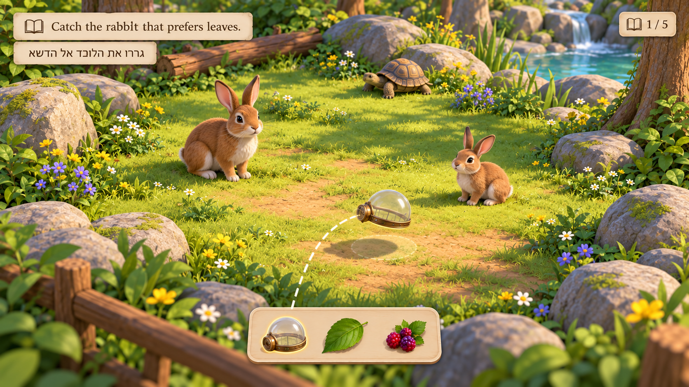
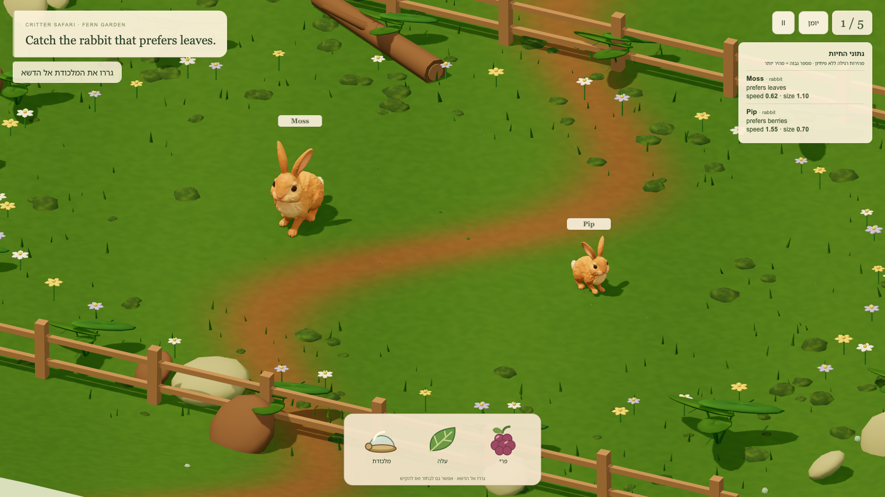
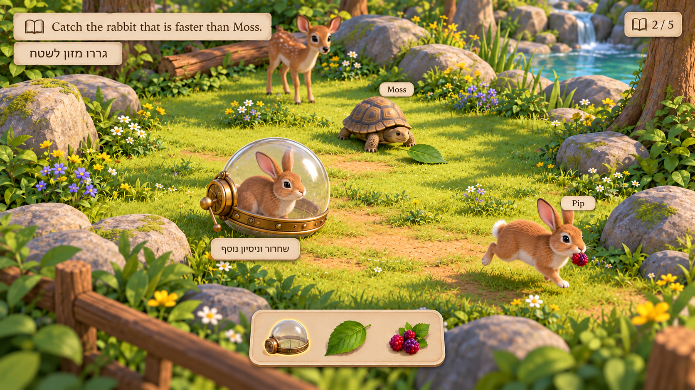
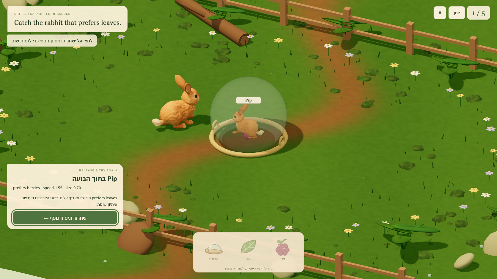
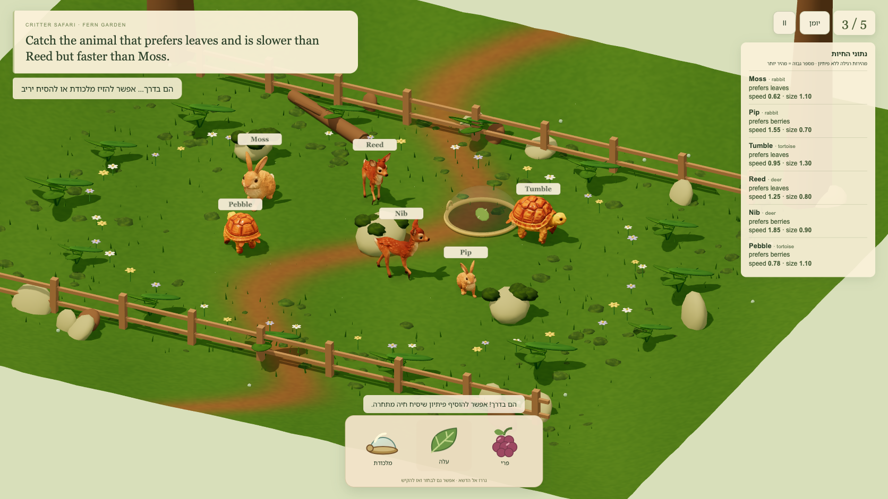

# Current campaign target/actual review —28 October2026

Both new built-in imagegen targets were generated and inspected before implementation (docs/visual-targets/campaign/PROMPTS.md). Actual views are separate under docs/actual-captures/campaign.

The functional journal exposes ten chapters/fifty stops, visible earned/current/locked states, resume/replay and local progress. It uses real HTML controls over the paused3D scene. The mockup's illustrated habitat thumbnails, leather binding and flanking animals are simplified to a restrained parchment journal; the mockup itself is never used as the interface.

The later gameplay target is implemented as ten real habitat arrangements, additional owned foliage, a reusable feeding bowl and a temporary calming patch, plus genuine2–3-rescue references whose original facts remain visible. The fixed camera, actual local weighted animal rigs and four-paw rabbit clips remain. No primitive creature substitute or new model generation was introduced.

Independent art review of the actual11/26/39/49 frames found boulders consistent with collision arrays, readable center lanes, visible imported bushes/cypresses/flowers and no obvious grounding or animal-pose regression. Snapshot render counters were46–51 calls/157,644–189,383 triangles before the final small label-guide refinement; these are scoped render snapshots, not FPS claims. Geometry/disposal checks separately cover all10 habitats and both reflections.

Honest fidelity remainder: ground cover and smooth boulders are simpler than the dense lush concept; the exterior pond reads as a pale basin; the data roster is a plain functional comparison list rather than illustrated cards. Clear traversable ground is preserved. Phone occlusion/help-focus issues identified from real screenshots were corrected. Independent final screenshot/input review passes: all6 animals/facts/five tools fit, names are separated with unobtrusive leader lines, help begins at its heading and both reflected late-level captures work. The long glossary still puts the return button below the fold; scrolling reaches it. No blocking visual issue remains in inspected views.

---

# Historical rebuild comparisons

# Rebuild visual review — 27 October 2026

## Fresh mockups before implementation

The user's feedback rejected the first-person flow and diagnostic creatures. Fresh built-in imagegen concepts were generated and inspected **before rebuilding gameplay**: first placement, a softer real-time style revision, and consequence/recovery. Exact prompts are in `docs/visual-targets/rebuild/prompts.md`; lead inspection is recorded beside them. The initial photoreal detail was rejected as an implementation target. The recovery concept's misplaced Moss tag above a tortoise was explicitly rejected as semantic truth.

The adopted direction is a sunny, open woodland diorama with a fixed elevated camera, recognizable animals, cream contract, one Hebrew action prompt and a tangible three-item tray. Actual rendering is real Three.js geometry with local skinned GLBs, lighting, shadows, picking, authored collisions and skeletal animation.

## Concept versus actual, same desktop viewport

| Rebuild concept | Actual rebuilt gameplay |
|---|---|
|  |  |
|  |  |

The first actual frame intentionally starts with only two rabbits. The later scene expands to six animals across rabbit, tortoise and deer families, keeping the same gestures. The concept images are targets, not screenshots of a shipped build.

## Findings and changes

- Replaced diagnostic silhouettes with three original Tripo animals after gallery inspection. Sculpted fur, long ears, patterned shell and a coherent small deer silhouette are now present, with real quadruped rigs and acquired Walk clips.
- Removed walking/aiming/pulse requirements. The fixed camera puts trap placement and lure response in one view. Holding a tray item pauses planning; the landing ghost agrees with valid world/UI regions.
- Opened the center and removed terrain-intersecting overlays that made jagged bands. Reduced moss/plant density and retained low perimeter rails, selective flowers and exact obstacle props. Contract1/2 have no central obstacle props.
- Brought the first pair closer, corrected label colour space/tone mapping and made preference facts readable. The first action needs no notes modal. Size differences are visible without encoding the answer in colour.
- Kept a compact transparent bubble and one release/continue card. Final mobile checks found stale caught-state guidance and overlapping unrelated labels; the prompt now matches the recovery action, the card names the individual, and other labels hide while caught.
- Explicit LTR English, progress counts and range controls sit within the Hebrew interface. Touch capture/release/retry at390×844 and desktop progression through the transfer were visually inspected.

## Remaining differences

This is a stylized real-time implementation. It has simpler grass, flatter terrain, harder shadows and less detailed vegetation than the concept; it does not match cinematic fur, dense foliage, soft depth of field or every HUD position. The first level's camera is closer than later levels to teach the gestures. The bubble is larger relative to animals during review, and the mobile recovery card occupies part of the world to preserve readable feedback and a usable button.

The imported deer/tortoise clips and authored rabbit Walk/Trot supply locomotion only. Stationary, planning and caught animals freeze their current gait pose; separate breathing, idle and capture skeletal performances have not been authored. The trap animation, bait arc, carried food and capture pop are local object effects. No exact visual-fidelity, learner-fun or learning-effectiveness claim is made.

Earlier targets and captures outside the `rebuild/` directories document the rejected first-person prototype and are not evidence of this version's current appearance or controls.

## Human-feedback refinement

The human's later screenshots showed detached feet/shadows, missing later-contract facts and unexplained empty-field placement rejection. The playable terrain is now exactly y=0, and precomputed support tracks ground the actual deformed Walk poses. Normal shadow bias is0.002, down from0.035. A sharper2048px cast shadow from a higher sun and a faint, small ground-contact ellipse complement the measured support; the ellipse hides during the bubble lift. The refined desktop frame above was inspected with rabbit, deer and tortoise in real play.

The facts roster stays visible during play, matching every world name, and expands to all six entries. The smaller ring and shared preview/validation function match, with a visible meadow boundary and precise reasons for invalid drops. Current frames are under `refinements/`; earlier rebuild frames preserve the before state. The score, semantics and acquired animal files are unchanged.

## Rabbit gait closeout

The human's10:19 screenshot exposed a real bipedal-looking rabbit gait that the earlier floor check missed. The source bind pose had grounded front paws; the generic Walk extended its hind legs and suspended the forepaws. Rabbit motion is now replaced with authored four-paw Walk/Trot on the actual acquired weighted skeleton. Full side and3/4 actual-loader sequences show a low torso, visible forepaw plants/recovery and folded hind hocks, with step cadence calibrated to world speed. The independent reviewer inspected normal and lure cycles and loop boundaries. Gait proof MP4s and ordered sheets are in `docs/actual-captures/refinements/`; current game frames above use the corrected motion. Foot support metrics supplement the motion review. The result remains a stylized walk/scurry.
