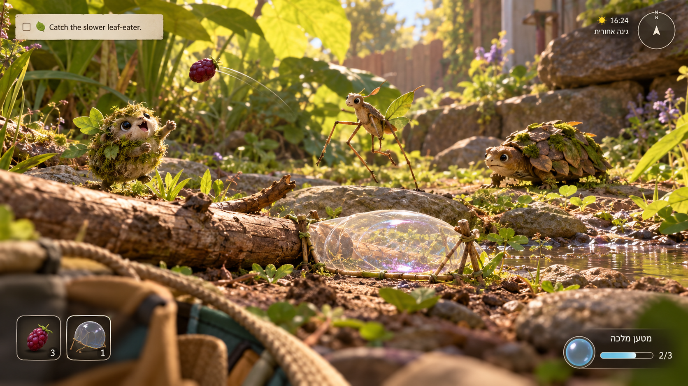
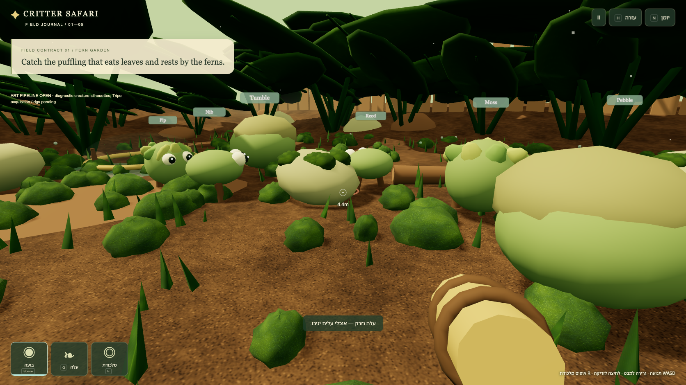
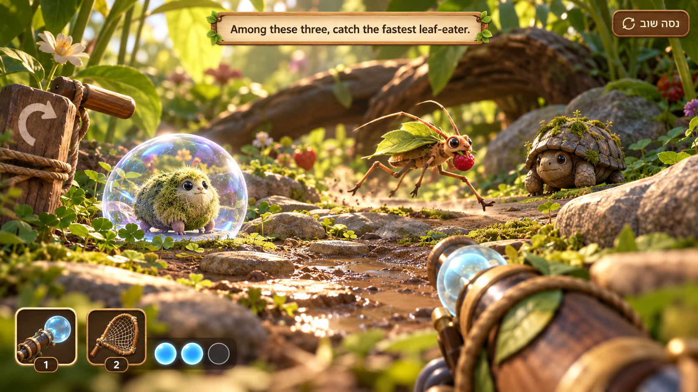
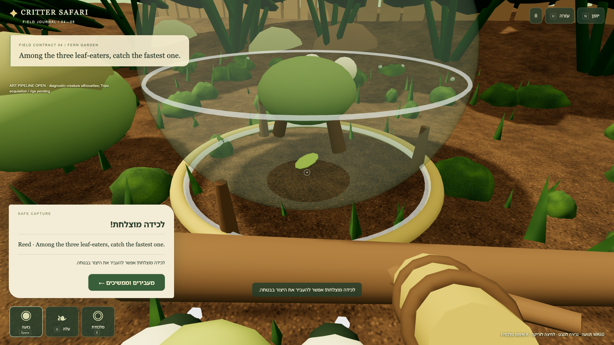
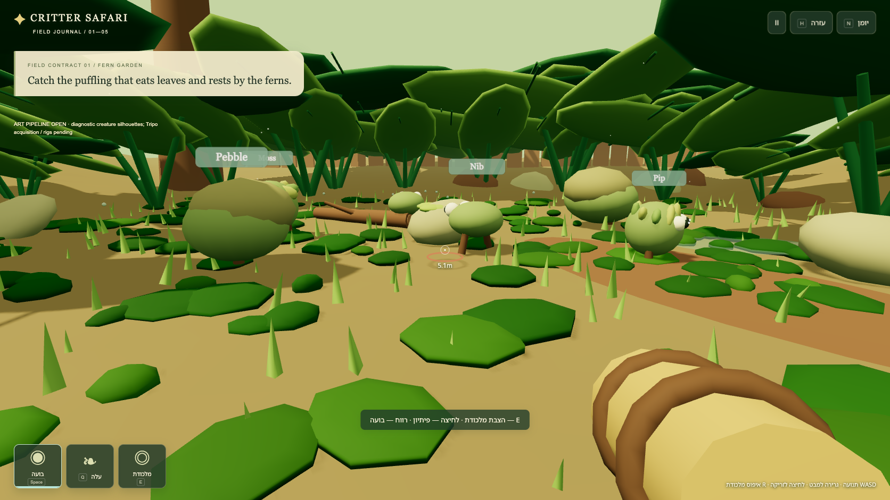
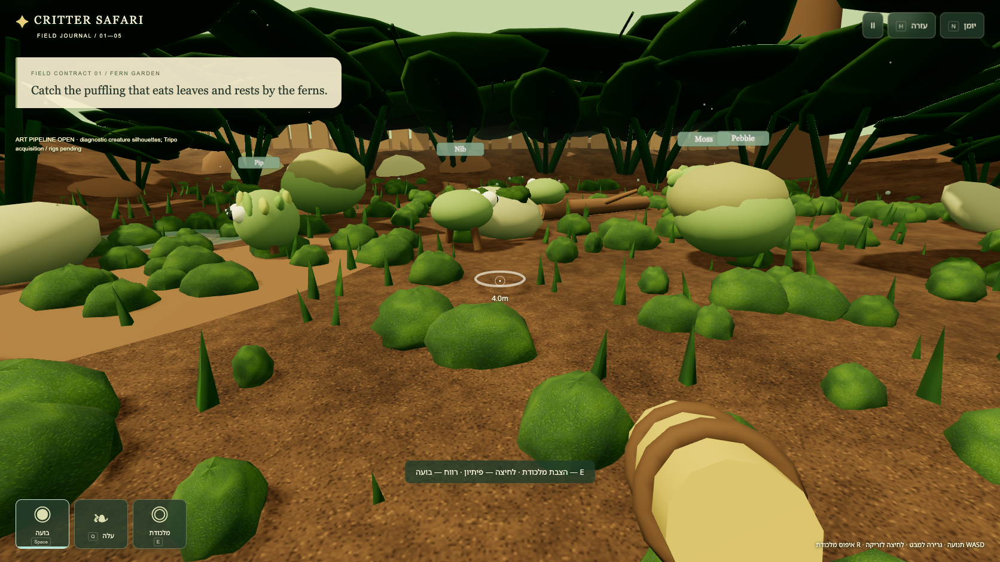

# Visual review

## Targets before implementation

Built-in image_gen produced two separate1672×941 concept views. The lead inspected target1 before gameplay source, and target2 before renderer work. Exact prompts and mode are under docs/visual-targets. Target1 establishes low first-person view, sunlit broad leaves, room to circle, bubble trap by twig, airborne lure and three natural creature silhouettes. Target2 establishes a captured puffling, escaping bait carrier and recoverable reset opportunity. Neither is a real capture.

## Concept versus actual gameplay

The comparisons use actual headed browser gameplay at the target viewport. Current creature geometry is explicitly diagnostic, with the Tripo art requirement open.

| Concept target | Actual gameplay |
|---|---|
|  |  |
|  |  |

## Findings and fixes

Lead and independent reviewer inspected first-view, lure, wrong catch, release, correct capture, transfer and completion frames. The real scene supplies eye-height depth, actual space to circle, matching solid stone landmarks, a twig, bubble ring/enclosure, a visible bait arc and a brass/wood gadget. The compact LTR parchment contract and Hebrew controls remain readable; captured feedback preserves the world instead of covering it with a full-screen grading popup.

The first actual build showed flat mustard soil, broad flattened moss polygons, overly large nearby name badges and gadget framing. Fixes: authored granular brown soil/roughness/bump, leaf veins, moss texture and smaller raised clumps; smaller constant-screen name badges; a compact gadget; capture actor pulled to the authoritative trap center; default aim brought inside trap range. Original pre-fix capture is retained separately below. The mobile journal initially clipped names from RTL scroll origin; LTR wrapper plus sticky names fixes that reading defect.

| Before material refinement | Latest actual view |
|---|---|
|  |  |

Lead and art owner inspected the refreshed1672×941 gameplay views plus390×844 mobile capture. Brown granular soil and raised textured moss now read clearly, and the smaller gadget leaves more world visible. Compact labels help scene readability, though nearby labels can still overlap. The target comparison remains an explicit partial match, with the required character pipeline open.

## Honest remainder

The gap to concept art is still substantial. Required natural creature silhouettes, fur/shell detail and squash/body animation require actual acquired Tripo models and rigs/clips; none was obtained after browser controls timed out. Diagnostic geometry is labeled and cannot meet that acceptance gate. The environment is stylized authored geometry with procedural textures, without the target's dense photoreal surface detail or soft cinematic depth of field. The canopy is much darker and denser than the translucent sunlit target; bubble enclosure/rings are simpler and larger in close capture views. Mobile's success panel occupies a substantial part of the world while preserving the contract, creature and release/advance action. The target2 net icon is outside the specified two-tool scope; actual tools remain bait and reusable bubble trap. No final target-fidelity or completed character-art claim is made.
